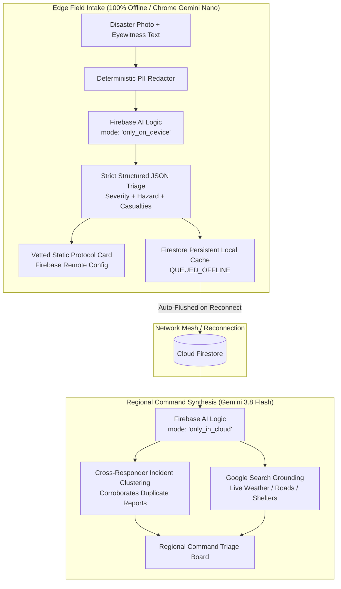

# TriageRelay 🚨

> *"Most AI apps treat offline as an error message. TriageRelay treats the dead zone as the product."*

**TriageRelay** is an offline-first multimodal emergency intake and disaster coordination Progressive Web App (PWA) built with **React 19, TypeScript, Vite, Tailwind CSS, and Firebase AI Logic**.

Built as a solo entry for the **#BuildHybridAI 2026 Hackathon** (targeting Best Web/Chrome App & Grand Prize contention).

---

## The Problem

During the first 72 hours of catastrophic natural disasters (earthquakes, flash floods, hurricanes), cellular base stations fail while field responders receive hundreds of chaotic eyewitness texts and damage photos. 
- **Pure Cloud AI fails:** It dies in dead zones and risks leaking Protected Health Information (PHI) and victim contact details over compromised public networks.
- **Pure On-Device AI fails:** A single responder's device cannot correlate reports across an entire disaster sector, identify duplicate incidents, or access live regional weather/road advisories.

---

## The Hybrid Split (Architecturally Mandatory)



### 1. Edge Field Intake (`ONLY_ON_DEVICE` via Chrome Gemini Nano)
- **Zero Cloud Leak:** Takes disaster photos (JPEG/PNG) and unstructured eyewitness reports 100% offline.
- **Deterministic + AI PII Redaction:** Phone numbers, Social Security Numbers, street addresses, emails, driver's licenses, and victim names are scrubbed locally while keeping highway corridors intact.
- **Strict Structured JSON Schema:** Outputs typed triage classifications without free-form hallucinated medical advice.
- **Vetted Protocol Cards:** Maps the classified hazard type directly to curated FEMA / CERT / NWS / OSHA safety checklists controlled via **Firebase Remote Config**.

### 2. County EOC Command Synthesis (`ONLY_IN_CLOUD` via `gemini-3.8-flash`)
- **Corroborates Multi-Source Incidents:** Groups duplicate reports describing the same incident across responders by county and highway corridor.
- **Google Search Grounding:** Augments situational briefs against live NWS alerts, state DOT road closures, and Red Cross shelter advisories.

---

## Firebase Stack & Runtime Architecture

| Firebase Service | Purpose in TriageRelay | Runtime Implementation |
| :--- | :--- | :--- |
| **Firebase AI Logic (`firebase/ai`)** | Dual Hybrid Inference Engine | `getGenerativeModel(ai, { mode: InferenceMode.ONLY_ON_DEVICE, onDeviceParams: ... })` for edge intake, and `getGenerativeModel(ai, { mode: InferenceMode.ONLY_IN_CLOUD, inCloudParams: { model: "gemini-3.8-flash", tools: [{ googleSearch: {} }] } })` for command synthesis. |
| **Cloud Firestore** | Offline-First Data Store | Configured with `persistentLocalCache({ tabManager: persistentMultipleTabManager() })` to buffer reports in dead zones and auto-sync to `SYNCED` when online. |
| **Firebase Remote Config** | Dynamic Safety Protocols | Fetches `active_disaster_protocol` (`EARTHQUAKE` vs `FLASH_FLOOD`) and vetted safety cards without redeploying code. |
| **Firebase App Check** | Anti-Abuse & Cloud Protection | Initialized with `ReCaptchaEnterpriseProvider` and `FIREBASE_APPCHECK_DEBUG_TOKEN = true` for compliant evaluation. |
| **Firebase Auth** | Zero-Friction Responder ID | Silent `signInAnonymously(auth)` on startup to authenticate edge reports instantly. |

---

## Application Routes

* **`/` or `/report` (Incident Reporter):** Dedicated field intake terminal for attaching optional site damage photos and unstructured descriptions, performing local PII scrubbing and hazard classification with curated safety guidance.
* **`/dispatch` (Dispatch Center):** Dedicated coordinator receiver view showing real-time incoming reports, verification state, and multi-report situational briefing generation.

---

## Quickstart & Local Setup

### Prerequisites
- Node.js 18+ and npm
- Chrome v139+ with Gemini Nano flags enabled (or use built-in Nano Simulation fallback)

### Installation
```bash
# Clone the repository
git clone https://github.com/Vezzyyy/TriageRelay.git
cd TriageRelay

# Install dependencies
npm install

# Start local development server
npm run dev
```

### Environment Variables (`.env.local`)
Create a `.env.local` file with your Firebase credentials:
```env
VITE_FIREBASE_API_KEY=your_api_key
VITE_FIREBASE_AUTH_DOMAIN=your_project.firebaseapp.com
VITE_FIREBASE_PROJECT_ID=your_project_id
VITE_FIREBASE_STORAGE_BUCKET=your_project.appspot.com
VITE_FIREBASE_MESSAGING_SENDER_ID=your_sender_id
VITE_FIREBASE_APP_ID=your_app_id
VITE_FIREBASE_APPCHECK_DEBUG_TOKEN=true
```

*(Note: TriageRelay includes automatic fallback initialization so the entire PWA and offline pipeline runs cleanly even before credentials are provided).*

---

## License

Licensed under the [Apache License, Version 2.0](LICENSE).
